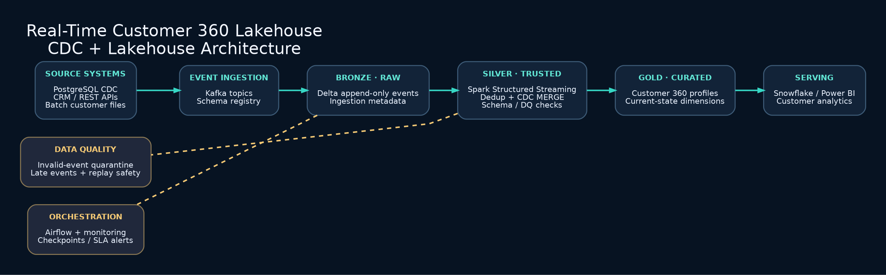

# Real-Time Customer 360 Lakehouse

### End-to-End Data Engineering | CDC | Kafka | PySpark | Delta Lake | Databricks

## Target Architecture



## Project Overview

The **Real-Time Customer 360 Lakehouse** is a data engineering project designed to integrate customer information from multiple operational systems into a unified, analytics-ready customer view.

The target architecture combines real-time Change Data Capture (CDC), event-driven ingestion, distributed stream processing, and Delta Lake Medallion Architecture to support scalable and reliable customer data processing.

The project focuses on designing reusable data pipelines with strong data quality, incremental processing, fault tolerance, and observability.

**Status: Working local CDC prototype; Kafka, Spark, Delta Lake, Databricks and Airflow integrations are planned.**

An independent Customer 360 project using **synthetic CRM customer events** (not NYC Taxi data). Demonstrates change-data-capture upserts, deduplication, late-event protection, data-quality quarantine, and a customer 360 current-state table.

## Target architecture
PostgreSQL / APIs → Kafka → Spark Structured Streaming → Delta Lake Bronze/Silver/Gold → Databricks → Snowflake / Power BI

## Implemented locally
- Read JSONL customer CDC events; preserve append-only bronze events.
- Validate customer ID, email, and operation; quarantine invalid events.
- Apply last-write-wins CDC merge using event timestamps and event IDs.
- Materialize `customer_360.json` and `quarantine.json`.
- Standard-library unit tests.

## Run
```bash
python3 src/customer360.py --input sample_data/customer_events.jsonl --output output
python3 -m unittest discover -s tests -v
```

## Planned milestones
1. Add PostgreSQL Debezium CDC and Kafka topics.
2. Implement Spark Structured Streaming with Delta MERGE and checkpointing.
3. Add SCD Type 2 history, schema evolution and backfills.
4. Orchestrate with Airflow; add observability and CI/CD.

See `docs/architecture.md`. Synthetic sample data only. No production throughput or cloud deployment claims.
