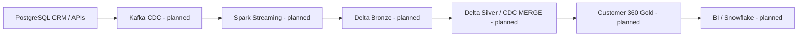

# Architecture

**Local runnable slice:** JSONL events → validation/quarantine → ordered CDC merge → current customer view.

**CDC rules:** `UPSERT` or `DELETE`; later event timestamps win, event_id breaks ties; invalid IDs/emails quarantined. Deletes produce tombstones in current view. In production, ordering requires source LSN/sequence and partition-key guarantees, not timestamps alone.
