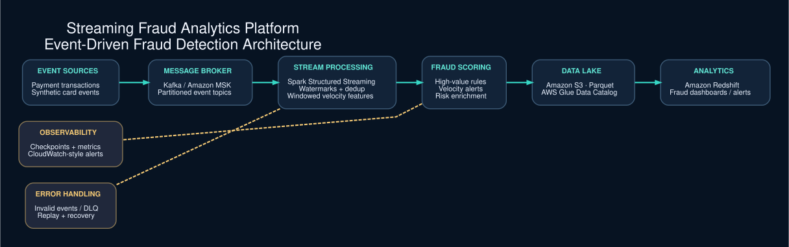

# Streaming Fraud Analytics Platform



> **Architecture status:** Local Python event-stream simulation implemented; Kafka/MSK, Spark, AWS S3, Glue, Redshift are planned. The diagram illustrates the target design, not a completed cloud deployment.


**Status: Working local event-stream simulation; Kafka/MSK, Spark Streaming, AWS S3, Glue and Redshift integrations are planned.**

An independent streaming fraud analytics project using **synthetic card transactions** (not NYC Taxi data). Detects unusual high-value transactions and rapid spending bursts using configurable rules.

## Target architecture
Transaction Producers → Kafka / MSK → Spark Structured Streaming → S3 → Glue Catalog → Redshift → Fraud Analytics

## Implemented locally
- Process newline-delimited transaction events sequentially.
- Deduplicate by `transaction_id`.
- Detect large transactions and velocity bursts within a configurable lookback window.
- Route invalid transactions to quarantine and write alert JSON.
- Standard-library unit tests.

## Run
```bash
python3 src/fraud_stream.py --input sample_data/transactions.jsonl --output output
python3 -m unittest discover -s tests -v
```

## Planned milestones
1. Kafka producer/consumer with partitioning by account ID.
2. Spark Structured Streaming watermarking and event-time windows.
3. Checkpoint/replay safety and dead-letter topic.
4. S3 Parquet sink, Glue metadata, Redshift fraud marts, CloudWatch dashboards.

**Note:** Local velocity logic is a simplified ordered-event prototype, not a production fraud model or a Spark watermark implementation. No cloud deployment is claimed.
