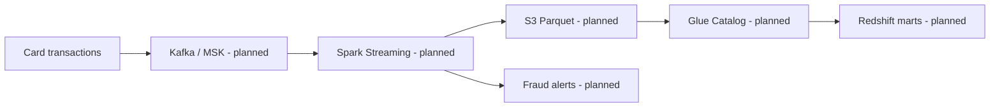

# Target architecture

**Local runnable slice:** JSONL event file → deduplication + rule engine → alert JSON / quarantine.

**Production considerations:** event-time windows and watermarks, state TTL, exactly-once sink semantics, replay safety, PII handling, rule calibration, and monitoring false positives.
